<div align="center">

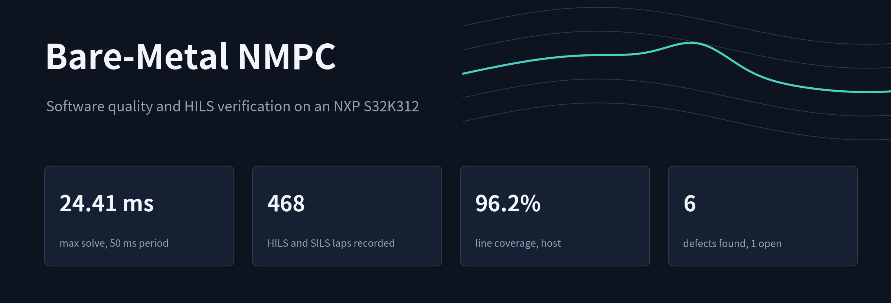


[Results](#results-at-a-glance) · [Setup](#setup) · [Strategy](#test-strategy) · [Coverage](#unit-tests-and-coverage) · [Mutation](#mutation-testing-and-injected-defects) · [Defects](#defects-found) · [HILS](#hils-results) · [Failure analysis](#failure-analysis-ac-10) · [Limitations](#limitations)

</div>

---

A nonlinear MPC runs without an OS on an automotive MCU (NXP S32K312, Cortex-M7, 120 MHz). This repository records how it was verified with unit tests, coverage, mutation testing, fault injection and hardware-in-the-loop (HILS) runs on a real board. It includes the defects found and the criteria that failed, not only the passing results.

> No MISRA or ISO 26262 compliance is claimed. Testing was done in a simulator. There was no vehicle test.

## Results at a glance

| Area | Result | Scope |
|---|---|---|
| Unit tests | **All 7 test executables pass**, 0 ASan or UBSan errors | Host, 2026-11-07, published code |
| Coverage | Line **96.2%** (1457/1514), branch **83.5%** (850/1018) | Host, excludes `platform/` and `test/` |
| Mutation | QP comparison **27 → 66/81**, arithmetic **99 → 127/127** | 2026-11-05, not rerun after the later QP fix |
| Compiler warnings | `-Wall -Wextra`: 0, `-Wconversion -Wshadow`: 2 | Core and safety modules |
| Real-time | Max solve **24.41 ms**, max round trip **38.88 ms**, 50 ms period | Real board, measured, not a WCET bound |
| HILS | **468 laps recorded, 397 valid** | MORAI K-City, one scenario |
| Path error criterion AC-10 | **Failed**: 29 of 63 judged laps exceeded 0.80 m | See the failure analysis below |

## Setup

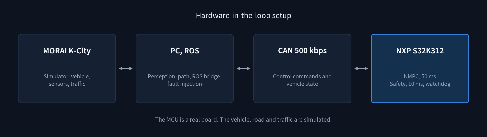

## Test strategy

| Layer | Method | What it can find |
|---|---|---|
| Unit tests | Separate double, float and safety builds | Logic and numerical errors |
| Coverage | gcovr line and branch | Code that never ran |
| Mutation | Change comparison and arithmetic operators, check that tests fail | Weak tests |
| Injected defects | 136 hand-written defects in the QP solver | Gaps coverage cannot show |
| Sanitizers | ASan and UBSan | Memory errors and undefined behavior |
| HILS | Real board in closed loop with delay, communication, steering and MCU hang faults | Timing and integration defects |
| Randomized blocks | Mix firmware versions within a session | Separates fix effects from session effects |

## Unit tests and coverage

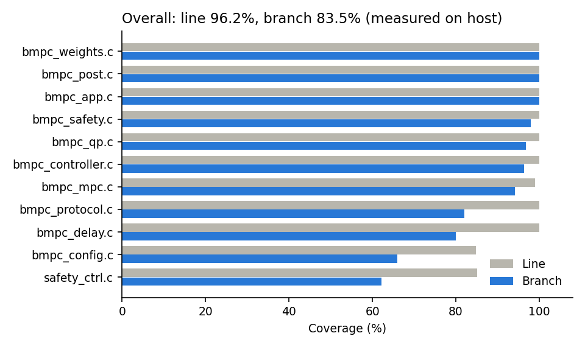

```sh
sut/run_tests.sh   # unit tests, no board or ROS needed
sut/quality.sh     # coverage and sanitizers, needs gcovr
```

Weak spots are shown as measured: `safety_ctrl.c` has 62.2% branch coverage and `bmpc_config.c` has 65.9%. Data is in `verification/results/coverage_summary.json`.

**A measurement mistake was also found.** An early coverage baseline counted only the last test, because rebuilding in one folder overwrote the `.gcno` files. Each test now has its own build folder.

## Mutation testing and injected defects

Measured on 2026-11-05. **The QP and safety code changed after that, and these were not rerun.** Values are before and after strengthening the tests. Surviving mutants include likely equivalent ones.

| Target | Before | After | Total |
|---|---:|---:|---:|
| `bmpc_qp` comparison (double) | 27 | **66** | 81 |
| `bmpc_qp` comparison (float) | 11 | **66** | 81 |
| `bmpc_qp` arithmetic (double) | 99 | **127** | 127 |
| `bmpc_qp` arithmetic (float) | 46 | **127** | 127 |
| `bmpc_safety` | 17 | **42** | 45 |
| `bmpc_controller` | 4 | **30** | 34 |
| `bmpc_post` | 0 | **22** | 28 |
| `bmpc_app` | 15 | **19** | 21 |
| `bmpc_protocol` | 14 | **15** | 25 |

Of the 136 injected QP defects, detection rose from **73 to 124** in double and from **22 to 126** in float.

## Defects found

| Defect | Found by | Action |
|---|---|---|
| QP spent its iteration cap on zero-length steps | Code review, host reproduction, HILS | Fixed, regression tests added (`defects/`) |
| That fix raised false OK cases | Independent counterexample | Fixed again, some cases remain |
| Safety controller missed bad steering commands | Fault injection | Added a plausibility check |
| Watchdog was disabled | Code review | Enabled and tested |
| Stale bridge binary ignored injection commands | Log review | Rebuilt, 11 laps voided, injection check added |
| Steering check can release during a fault and hold steering on recovery | Bag analysis | **Open, redesign candidate** |

## HILS results

### Randomized blocks: QP fix
48 laps. Paired difference in the M5 60-80 m window: -0.064 m (21 pairs, p=0.0001).

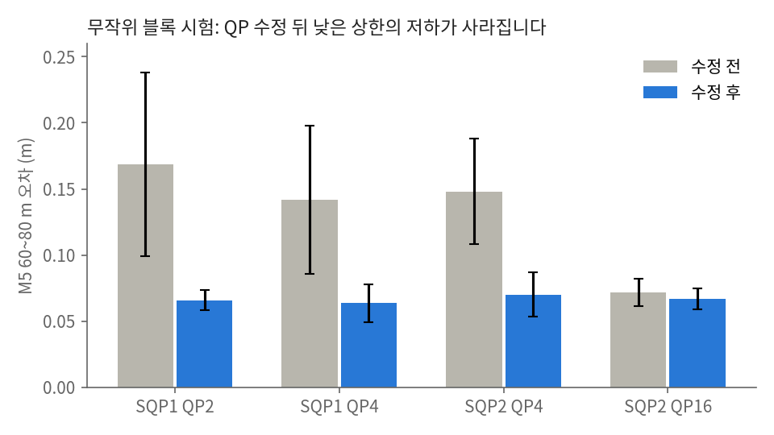

### Solve time and delay compensation
| Solve time | Delay compensation |
|---|---|
| 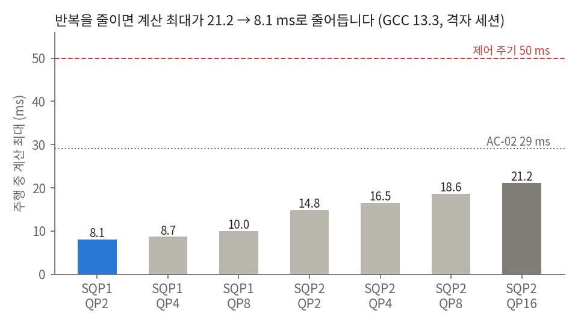 | 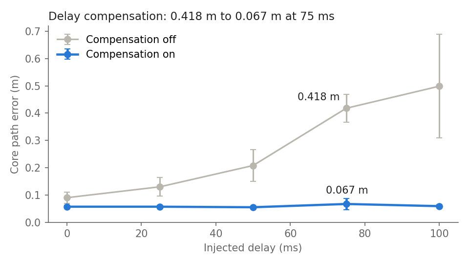 |

The delay runs were sequential, so session effects may be mixed in.

### Fault injection
| Communication faults | Curve steering faults |
|---|---|
| 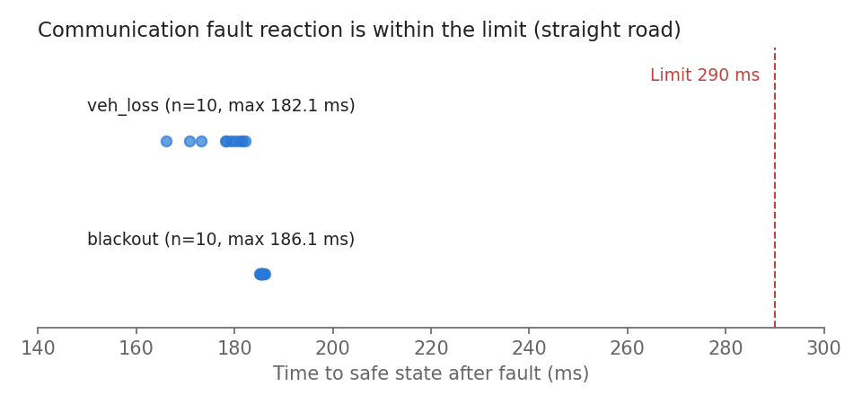 | 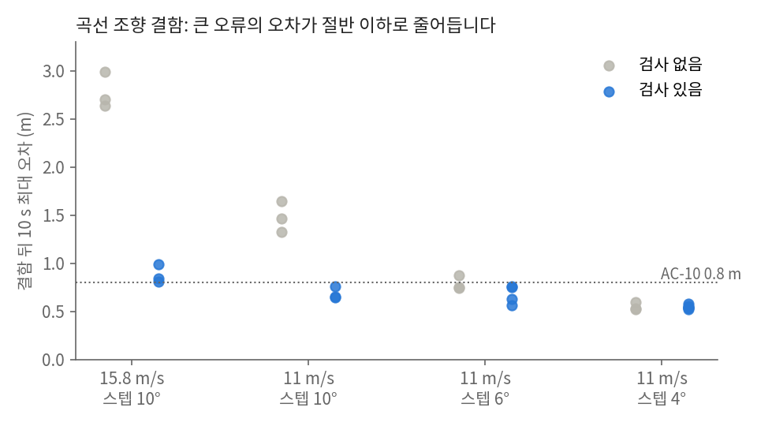 |

- Communication faults were injected on straight road. Steering faults have 3 laps per condition.
- The 4° step was not detected.
- In MCU hang tests, safe stop took 0.176-0.182 s and normal state returned at 2.54-2.55 s. The PC bridge did the braking.

## Failure analysis: AC-10

Using a wider set of 70 judged laps, the 35 laps above 0.8 m were classified. **The verdict was not changed.**

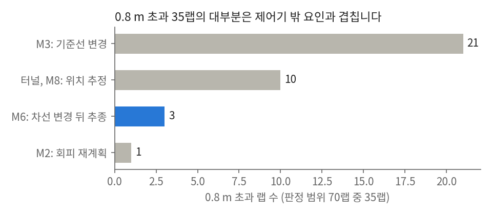

| Section | Laps | Evidence |
|---|---:|---|
| M3 | 21 | Car within 0.08 m of the path before entry. After avoidance, the reference returned to the centerline at the zone boundary |
| Tunnel exit, M8 | 10 | EKF-based error at most 0.52 m, EKF to GPS difference 3.5-8 m |
| M6 | 3 | EKF-based error also 1.5-2.1 m after a lane change. **Controller candidate, cause not confirmed** |
| M2 | 1 | During avoidance replanning |

| M3 reference change (1 SILS lap) | Lidar map (no NPCs, 3 laps) |
|---|---|
| 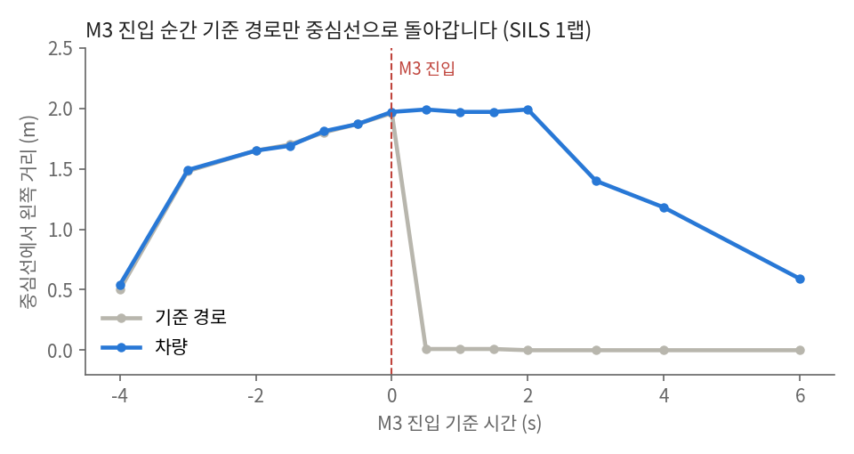 | 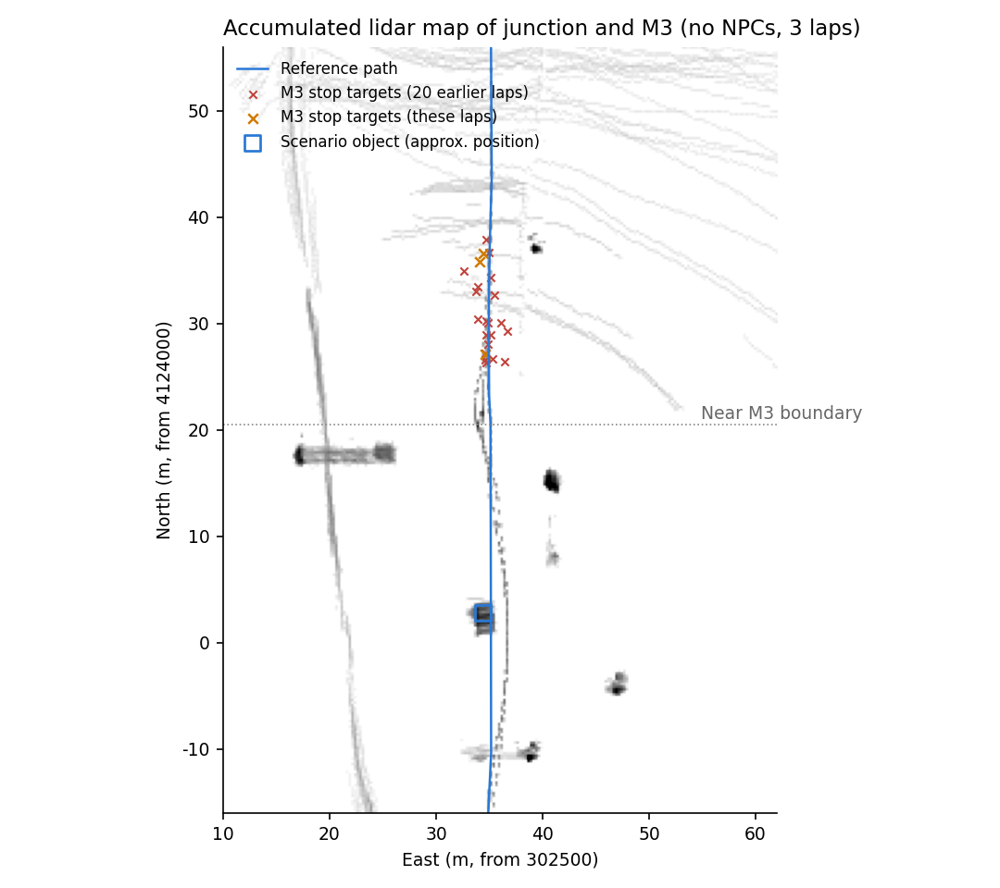 |

No upright object was visible at the M3 stop target from 8 m, so a road-surface false detection is suspected but not confirmed. With a metric defined in advance that removes 3 s after each reference change, 22 of 70 laps still exceeded 0.8 m.

## Data integrity rules

- Criteria and their change log are public in `docs/acceptance_criteria.md`. They were set after the first 7 laps, and some calculation scopes changed after failures were seen.
- Suspect laps are flagged, not deleted.
- Added metrics are defined before results are viewed and logged in `docs/decisions.md`.

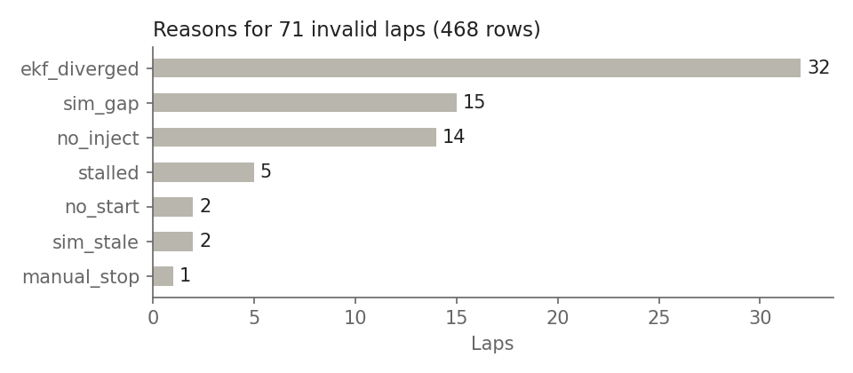

In 30 of the 32 `ekf_diverged` laps, the lateral difference at the peak was under 1 m, so time lag may be mixed in. The rule was not changed.

## Limitations

- Simulator and one scenario only, with no vehicle test.
- Coverage and mutation results come from the host, not the S32K312.
- Measured execution times are not a WCET bound.
- The final firmware has 2 of 30 planned normal laps.
- Safety functions share one MCU, so chip failure is not covered.
- Steering steps under 5° and held commands are not detected. Slowly growing errors were not tested.

## Repository layout

```text
sut/            MPC core, safety integration, firmware, ROS bridge, unit tests
verification/   test plans, runner, results, figures
defects/        fix patches
docs/           acceptance criteria, full analysis, decision log (in Korean)
```

Reproducing HILS needs the board, a MORAI license and the full ROS stack, which are not all included here.

## License and authorship

- License: not chosen yet.
- AI tools (Claude Code) were used for implementation and analysis.
